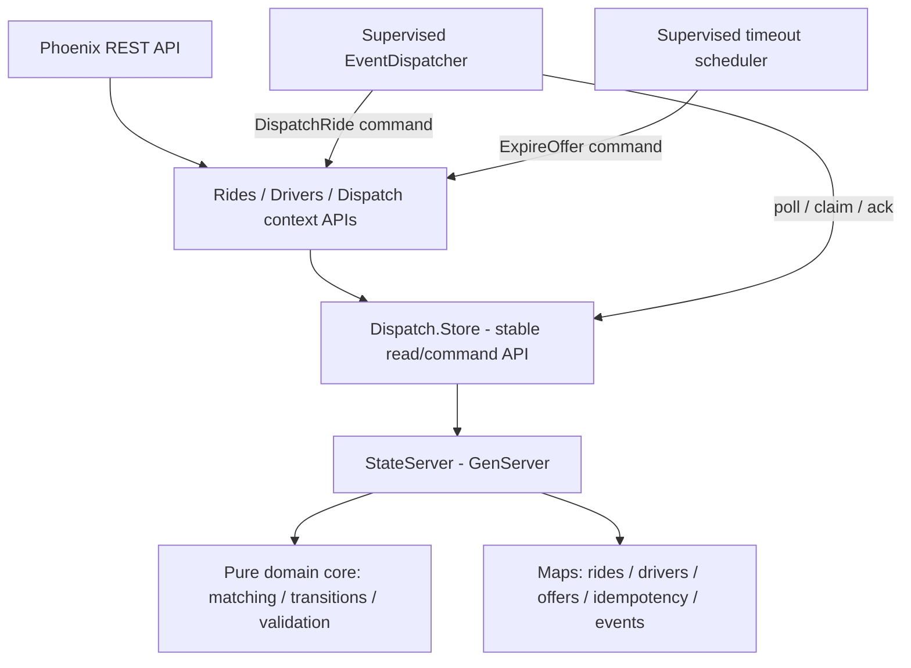

# Coding Challenge #3 — Hướng dẫn triển khai chuẩn TDD và Git

> **Bản thiết kế đề xuất:** Elixir + Phoenix API-only + một GenServer làm nguồn state có thẩm quyền + in-memory event queue/dispatcher; **không bắt buộc PostgreSQL, ETS, Docker**. Đây là giải pháp cho phạm vi cuộc thi, không phải kiến trúc production đa node.
>
> **Mục tiêu:** Đạt toàn bộ AC-01…AC-10, các yêu cầu testing, architecture, scalability, observability và documentation. Không dùng timebox để cắt bỏ AC.

## A. Phân biệt yêu cầu đề và quyết định thiết kế

**Trạng thái tài liệu:** Đây là kế hoạch triển khai đang phát triển, không phải bằng chứng hoàn thành AC. **IMPLEMENTED** = có code; **PLANNED** = chưa triển khai; **VERIFIED** chỉ áp dụng cho hành vi có tests đã chạy, không tự động cho toàn bộ AC. Đối chiếu tiến độ và các khoảng trống tại [AC traceability](ac-traceability.md).

**IMPLEMENTED hiện tại:** `Location.valid?/1`, `Location.distance_km/2`, `Dispatch.Matcher.nearest/3`, `Drivers.StateMachine.transition/2`, `Rides.StateMachine.transition/2`, Driver HTTP và Ride POST/GET. Store/StateServer giữ Driver, seeded Passenger, Ride, creation idempotency và pending RideCreated records. **PLANNED:** RideOffer, lifecycle integration, reservation, rematching workflow và asynchronous dispatch. Phoenix.PubSub đang được supervise nhưng chưa có dispatch event bus/handler.

**Đề bắt buộc:** API Ride và Driver; trạng thái Driver (`OFFLINE`, `AVAILABLE`, `OFFERED`, `BUSY`), trạng thái Ride (`REQUESTED`, `MATCHING`, `DRIVER_ASSIGNED`, `DRIVER_ACCEPTED`, `CANCELLED`, `COMPLETED`); tọa độ hợp lệ; nearest available trong bán kính 2 km, tie-break theo `driverId`; pending offer và timeout mặc định 30 giây; accept/reject/cancel/complete; loại tài xế đã từ chối/hết hạn khỏi các lần matching sau của cùng Ride; `Idempotency-Key` và duplicate-safe transitions; concurrency test với **hai rides khác nhau** tranh một driver; event-driven dispatch; automated tests; logs với `rideId`, `driverId`, `eventId`; README, architecture diagram, sequence diagram, hai ADR; scaling 1k/100k/1m drivers, tối thiểu 3 bottlenecks/3 strategies/2 trade-offs.

**Đề cho phép, không bắt buộc:** in-memory repository và event bus; real DB và message broker; Docker. Nếu dùng external infrastructure phải hướng dẫn khởi chạy.

**Chúng ta chọn:** `Dispatch.Store` là API ổn định cho application layer; bản đầu dùng `GenServer + Map` làm nguồn state có thẩm quyền, state transitions qua pure functions, hàng đợi event trong RAM được dispatcher tiêu thụ bất đồng bộ, Phoenix JSON API. **Chưa thêm ETS**; giữ khả năng bổ sung ETS làm read projection khi đo được read bottleneck. PostgreSQL là phương án evolution khác, không phải yêu cầu của đề.

**Cảnh báo:** In-memory state **không bền vững sau khi state owner/application chết**; không được quảng cáo là crash-durable hoặc multi-node safe. Sự kiện chờ xử lý cũng mất nếu chính state owner mất. Đây là known limitation cần ghi rõ. Khi event worker chết nhưng state owner còn sống, event chờ xử lý có thể được retry.

## B. Đánh giá kiến trúc và trade-offs

| Phương án | Lợi ích | Chi phí và giới hạn | Kết luận |
|---|---|---|---|
| PostgreSQL + Ecto | Transaction, constraints, dữ liệu bền | Cần server, cấu hình DB, test setup, I/O/lock contention | Hợp lệ, không cần cho bản hiện tại |
| **Một GenServer sở hữu toàn bộ state** | Atomic multi-object mutation trong một callback; không cần external DB | Mailbox tập trung, mất state khi process chết, chưa multi-node | **Chọn** |
| ETS + coordinator | Read/write concurrency cao hơn ở một số workload | Khó giữ invariant xuyên nhiều object, phải tự phối hợp | Chỉ thêm khi có benchmark |
| GenServer/Driver | Parallelism theo driver | Routing, multi-actor consistency, lifecycle, multi-node | Future scaling |

**Nguyên tắc kiến trúc:** application/controllers/workers gọi `Dispatch.Store`, không gọi trực tiếp `GenServer.call` hoặc truy cập Maps nội bộ. Chỉ state owner được cập nhật các Maps/Offer; về sau nếu thêm ETS read projection thì chỉ owner được ghi vào projection. Chức năng thuần (`Matcher`, `StateMachine`, `Domain`) kiểm tra và tính trạng thái mới; `StateServer` là nơi chấp nhận lệnh và áp dụng một snapshot mới nguyên tử. Không gọi external HTTP hay chạy công việc chờ lâu trong callback của GenServer. Việc xử lý message của một server tuần tự không biến **toàn bộ cluster** thành một transaction.

### Sơ đồ logic mục tiêu — PLANNED cho Ride/Offer/Event

Hiện tại: `DriverController → Dispatch.Store → Dispatch.StateServer`; Ride HTTP dùng `RideController → Rides → Dispatch.Store → Dispatch.StateServer`; `Location`, `Drivers.StateMachine` và `Dispatch.Matcher` là functional core. Matcher chưa được nối vào Store/ride dispatch. Sơ đồ dưới đây mô tả kiến trúc mục tiêu, không phải toàn bộ code hiện có.



**IMPLEMENTED:** `CreateRide` tạo Ride, idempotency record và pending `RideCreated` trong cùng một lần đổi state. **PLANNED:** `EventBus`/`EventDispatcher` tiêu thụ pending events bất đồng bộ; chưa có delivery hoặc matching. `POST /rides` hiện không thực hiện matching.

## C. Git và cài môi trường — từng lệnh

Các lệnh bootstrap dưới đây là hướng dẫn lịch sử cho project mới, không phải yêu cầu chạy lại trên repo hiện tại. Chỉ commit khi task hiện hành cho phép; push và thay đổi lịch sử cần phê duyệt riêng theo `AGENTS.md`. Khi có thay đổi không liên quan, stage từng file cụ thể của task, không dùng lệnh stage rộng trong các ví dụ.

### C1. Chuẩn bị

Cài Git, Erlang/OTP và Elixir theo hướng dẫn chính thức; ưu tiên phiên bản được hỗ trợ bởi Phoenix generator. Kiểm tra:

```bash
elixir --version
mix --version
git --version
mix archive.install hex phx_new
mix phx.new --version
```

Tài liệu Phoenix 1.8.16 xác nhận có `--no-ecto`; app không dùng Ecto **không chạy** `mix ecto.create` hoặc `mix ecto.migrate`.

### C2. Fork và clone **đúng repo cuộc thi**

1. Fork official repository trên GitHub bằng giao diện web (theo chính sách repo).
2. Copy URL **của fork**, không phải official repo.
3. Thực hiện:

```bash
git clone https://github.com/YOUR_USERNAME/REPO_NAME.git
cd REPO_NAME
git remote -v
git remote add upstream https://github.com/ORGANIZER/REPO_NAME.git
git remote -v
git status
```

`origin` phải là fork; `upstream` phải là official repository. Nếu `upstream` đã tồn tại, kiểm tra trước khi thêm. Nếu official default branch không phải `main`, dùng tên branch thực tế.

**Cảnh báo công khai:** Fork của public repository cũng public; không thể đổi riêng fork thành private. Nếu muốn bảo mật bài trước deadline, hỏi organizer phương án private workspace hợp lệ. Đề nói mở PR *sau deadline*, và chỉ commits trước deadline được tính.

### C3. Working branch và project path

Từ **root fork**:

```bash
git switch main
git pull --ff-only origin main
git switch -c coding-challenge-3/my-team
mix phx.new coding-challenge-3/my-team \
  --app ride_dispatch \
  --module RideDispatch \
  --no-ecto --no-html --no-assets \
  --no-dashboard --no-mailer --no-gettext
cd coding-challenge-3/my-team
mix deps.get
mix test
mix phx.server
```

Thay `my-team` bằng tên nhóm thực tế, đảm bảo đường dẫn chưa chứa app khác. Tên branch có `/` là hợp lệ và **khác** tên thư mục team dù cùng chuỗi. `--no-ecto` làm các Ecto-centric generator không phù hợp; viết API/controller/context thủ công. Root `/` có thể 404 khi chưa khai báo route; điều đó không chứng minh server lỗi.

**Chỉ lúc baseline tests chạy được mới commit:**

```bash
git status
git add -A
git diff --cached --name-only
git diff --cached --stat
git diff --cached
git commit -m "chore: bootstrap Phoenix API-only app without Ecto"
```

`git add -A` không có pathspec sẽ stage các thay đổi trong toàn bộ repository, kể cả khi chạy từ thư mục Phoenix hiện tại. Nếu chỉ muốn stage các thay đổi trong thư mục hiện tại và các thư mục con, dùng `git add -- .`; **kiểm tra danh sách staged files trước khi commit**. Không được đưa credentials, `.env`, tokens hoặc private keys vào Git.

### C4. Công thức Git cố định cho từng vòng TDD

**RED**: viết *một* behavior test, chạy `mix test path/to/test.exs`; xác nhận thất bại đúng vì behavior chưa có:

```bash
git status
git add test/path/to/test.exs
git diff --cached
git commit -m "test(matching): nearest available driver - RED"
```

**GREEN**: code tối thiểu để pass:

```bash
mix test path/to/test.exs
mix test
git add lib/path/to/implementation.ex
git commit -m "feat(matching): choose nearest available driver - GREEN"
```

**REFACTOR**: chỉnh code, không đổi behavior, chạy tests lại:

```bash
mix format
mix test
git add lib test
git commit -m "refactor(matching): extract distance calculator"
```

Một số vòng không cần refactor commit nếu không có thay đổi. Giữ các commit RED thực tế để hỗ trợ xét **TDD Bonus +5**; đừng tạo giả RED sau khi đã implement và đừng squash mọi commit trước khi nộp.

**Lệnh cứu hộ:** `git status`, `git diff`, `git diff --cached`, `git restore --staged FILE`, `git log --oneline --graph -20`, `git branch --show-current`. Không dùng `reset --hard` hoặc `push --force` như giải pháp mặc định.

## D. Domain model, state owner và invariants

### D1. Model

**IMPLEMENTED:** Driver dùng string `:id`, atom `:status` (`:offline`, `:available`, `:offered`, `:busy`) và atom keys `:latitude`/`:longitude`; Location nhận coordinate maps. StateServer giữ maps `drivers`, `passengers`, `rides`, `idempotency`, `pending_events`. Passenger và Ride đã IMPLEMENTED; RideOffer vẫn **PLANNED**.

- `Passenger`: `id` (seeded; registration out of scope).
- `Driver`: `id`, `status`, `latitude`, `longitude`.
- `Ride`: `id`, `passengerId`, `pickup`, `destination`, `status`, `assignedDriverId`.
- `RideOffer`: `id`, `rideId`, `driverId`, `status` (`PENDING`, `ACCEPTED`, `REJECTED`, `EXPIRED`, `CANCELLED`, `COMPLETED`), `expiresAt`, timestamps.
- `Location`: value object, validate latitude [-90,90], longitude [-180,180].

`RideOffer` fields/statuses là **lựa chọn implementation**, không phải status list được đề áp đặt. Một Ride có thể có nhiều offers lịch sử, nhưng chỉ một current offer. `assignedDriverId` của Ride phản ánh current offer/accepted ride; xóa khi rejection và timeout.

**IMPLEMENTED — pure contracts:**

- `Location.valid?(coordinate_map)` trả boolean; thiếu/invalid coordinates trả `false`, không ép numeric strings thành số.
- `Location.distance_km(from, to)` trả float km cho tọa độ hợp lệ, hoặc `{:error, :invalid_coordinates}`; Haversine dùng Earth radius 6,371 km.
- `Dispatch.Matcher.nearest(pickup, drivers, opts \\ [])` trả `{:ok, driver}`, `:none`, `{:error, :invalid_pickup}` hoặc `{:error, :invalid_radius}`. Options: `radius_km: 2.0` (inclusive), `excluded_driver_ids: []`. Chỉ chọn `:available` có tọa độ hợp lệ; bỏ qua malformed drivers; exact-distance ties chọn string ID nhỏ nhất theo lexicographic order. Caller phải cung cấp unique IDs và exclusion history của từng Ride; hàm không reserve hoặc lưu history.

### D2. Quy tắc state

**IMPLEMENTED:** `Drivers.StateMachine.transition(driver_map, action)` trả `{:ok, updated_driver}`, `{:error, :invalid_transition}` hoặc `{:error, :invalid_state}`; giữ nguyên các field khác. Public availability actions là `:enable_availability`/`:disable_availability`. Lặp lại availability đã thỏa mãn thành successful no-op là quyết định thiết kế, không phải response contract do đề bắt buộc. Internal actions (`:reserve_for_offer`, `:accept_offer`, `:reject_offer`, `:expire_offer`, `:cancel_offer`, `:complete_ride`, `:cancel_accepted_ride`) chỉ kiểm tra source state; không xác thực offer/deadline/ownership/idempotency hoặc tạo reservation. **IMPLEMENTED:** `Rides.StateMachine.transition(ride_map, action)` trả `{:ok, updated_ride}` hoặc `{:error, :invalid_state | :invalid_transition}`. Chỉ đổi status; các action là `:start_matching`, `:create_offer`, `:accept_offer`, `:reject_offer`, `:expire_offer`, `:complete_ride`, `:cancel_ride`. Terminal states không có outgoing transitions; repeated action bị từ chối nếu source state không còn phù hợp. Field khác được giữ nguyên, kể cả assignment. **PLANNED:** persisted lifecycle commands, assignment cleanup, offer identity/deadline checks và duplicate history.

```text
Ride: REQUESTED -> MATCHING -> DRIVER_ASSIGNED -> DRIVER_ACCEPTED -> COMPLETED
                           ^           |
                           +-- Reject/Timeout
Cancellation: REQUESTED, MATCHING, DRIVER_ASSIGNED, DRIVER_ACCEPTED -> CANCELLED
CANCELLED và COMPLETED là terminal.

Driver: OFFLINE <-> AVAILABLE -> OFFERED -> BUSY
                         ^         |         |
                         +---------+---------+
                         Reject/Timeout/Cancel/Complete tùy trạng thái
```

`OFFERED` và `BUSY` **không** được chuyển trực tiếp thành `OFFLINE` qua availability API. Mặc dù đoạn mô tả caller ở AC-05 không nhất quán hoàn toàn, AC-06 cho phép `DRIVER_ACCEPTED -> CANCELLED`, nên phải hỗ trợ trường hợp này và giải phóng Driver.

### D3. Invariants

Các multi-entity invariants dưới đây là **PLANNED**, chưa được chứng minh bằng pure State Machine/Matcher hoặc concurrency tests cho Driver updates. AC-09 cần hai Ride thật cạnh tranh cùng Driver sau khi reservation được triển khai.

- Mỗi Driver chiếm tối đa một Ride đang `DRIVER_ASSIGNED` hoặc `DRIVER_ACCEPTED`.
- Mỗi Ride có tối đa một active `RideOffer`.
- Accept/Reject chỉ áp dụng current pending offer đúng Driver; accept phải **trước** deadline.
- Driver đã REJECT/EXPIRED bị loại vĩnh viễn khỏi việc matching **cùng Ride**, nhưng vẫn nhận Ride khác.
- Hai terminal states không thể được mở lại.
- Duplicate create (cùng key/payload), accept và transitions không tạo side effects mới.
- Khi hết eligible drivers: Ride giữ `MATCHING`, `assignedDriverId = nil`.

### D4. `Dispatch.Store` interface, StateServer và trách nhiệm

Application layer chỉ phụ thuộc API `Dispatch.Store`; implementation ban đầu ủy quyền cho một `StateServer` (GenServer) giữ Maps. `server` là PID/name được inject để test từng instance độc lập.

```text
IMPLEMENTED — queries
Dispatch.Store.get_driver(server, driver_id)              # {:ok, driver} | :not_found
Dispatch.Store.list_available_drivers(server)             # list, lexicographic ID order
Dispatch.Store.get_ride(server, ride_id)                  # {:ok, current_ride} | :not_found

IMPLEMENTED — atomic commands
Dispatch.Store.set_driver_availability(server, driver_id, available?)
Dispatch.Store.update_driver_location(server, driver_id, location)
Dispatch.Store.create_ride(server, key, request)           # strict string-keyed request

PLANNED — signatures remain provisional
Dispatch.Store.dispatch_ride(server, ride_id, now)
Dispatch.Store.accept_offer(server, ride_id, driver_id, now)
Dispatch.Store.reject_offer(server, ride_id, driver_id, now)
Dispatch.Store.expire_offer(server, offer_id, now)
Dispatch.Store.cancel_ride(server, ride_id, now)
Dispatch.Store.complete_ride(server, ride_id, now)
Dispatch.Store.claim_event/ack_event/fail_event(...)
```

Hai Driver command **IMPLEMENTED** trả `{:ok, updated_driver}` hoặc `:not_found`; unknown ID được ưu tiên trước payload validation. Availability chỉ nhận boolean, input khác trả `{:error, :invalid_availability}`; lỗi State Machine (`:invalid_transition`/`:invalid_state`) được truyền nguyên trạng. Location nhận atom-key coordinate map, lỗi trả `{:error, :invalid_coordinates}`, extra fields bị bỏ qua. Lỗi không đổi state. Mỗi command đọc, validate và cập nhật trong một callback; không compose public reads/writes.

Lifecycle dùng `StateServer.start_link(opts)` và OTP child spec; Store không có lifecycle wrappers. Application supervise một owner tên `RideDispatch.Dispatch.StateServer`, với Passenger `P001` và Driver seeds rỗng. `drivers: [...]` khi khởi tạo instance nhận unique nonempty string IDs, coordinates hợp lệ, status `:offline`/`:available`; duplicate IDs và malformed seeds bị từ chối. `passengers: [...]` nhận records có unique nonempty string `id`, giữ unrelated fields; malformed/duplicate seeds bị từ chối. Không có public generic state setter. RAM mất khi owner chết; call timeout không hủy command đang chờ.

Các API **PLANNED** chưa có code/tests. Các hàm `get/list` là *queries*; `set/update/create/dispatch/accept/reject/...` là *atomic business commands*. **Không** hiện thực `accept_offer` bằng chuỗi lời gọi công khai `get_driver → update_driver → update_ride` vì các command khác có thể chen giữa. Multi-entity commands tương lai phải tạo snapshot mới nguyên tử trong **một** `handle_call`. `{result, new_state, emitted_events}` là đề xuất cho functional core tương lai, không phải contract hiện tại của `Drivers.StateMachine`. Callback chỉ serialize owned state, không tạo transaction cho external side effects.

**Lộ trình thêm ETS mà không phá domain contract:**

```text
Hiện tại:  Phoenix → Application → Dispatch.Store → GenServer + Map
Sau này:   Phoenix → Application → Dispatch.Store ─┬→ GenServer: writes / critical transitions
                                                  └→ ETS: read-only projection
```

- ETS chỉ là **read projection/cache**, không phải nguồn sự thật thứ hai. GenServer tiếp tục là authoritative owner của Ride/Driver/Offer và các invariants.
- Khi đọc từ ETS, dữ liệu có thể stale hoặc được thấy giữa các lần cập nhật projection. Matcher có thể lấy *candidate* từ ETS, nhưng lệnh `dispatch_ride` vẫn phải kiểm tra lại availability, vị trí cần thiết, exclusion và reserve tại coordinator **nguyên tử**. Không coi một danh sách đọc từ ETS là snapshot transactionally consistent.
- Nếu bổ sung ETS, ưu tiên bảng `:protected` để các process khác chỉ đọc; GenServer sở hữu bảng và là writer duy nhất. `read_concurrency: true` chỉ bật sau khi workload đo được phù hợp; có overhead và không luôn nhanh hơn.
- ETS gắn với lifecycle của owner; ETS cũng không tự cung cấp durability hay coordination đa node. Đổi Map sang ETS hoặc thêm cache không tự giải quyết matching O(n), bottleneck writes hay multi-node consistency.
- Bổ sung tests cho kết quả đọc và invariants khi chuyển backend/projection, đặc biệt: stale candidate bị từ chối khi reserve, updates phản ánh trong projection và không có hai nguồn ghi state.

**Độ khó ước tính (đánh giá thiết kế, không phải benchmark):** Map → ETS để lưu/đọc: thấp–trung bình nếu giữ ownership; thêm read cache/đưa reads khỏi GenServer: trung bình do cache consistency; chia GenServer theo driver: cao hơn vì multi-actor invariants; chuyển multi-node: cao và cần coordination/durability riêng. ETS không giải quyết hai thay đổi cuối.

### D5. ID và dữ liệu khởi tạo

**IMPLEMENTED:** Production seed Passenger `P001`; Drivers rỗng. Ride IDs `ride-N` và Event IDs `event-N` dùng `System.unique_integer([:positive, :monotonic])` trong callback: unique toàn VM, distinct prefixes, không bảo đảm uniqueness qua VM restart. Không có restored state hoặc distributed identity. **PLANNED demo:** Drivers `D001`/`D002`/`D003`.

## E. Lộ trình triển khai **TDD-first** (kế hoạch ban đầu, không phải tiến độ)

Thứ tự bảng này là kế hoạch ban đầu. Thực tế đã làm Location validation, Haversine, Matcher, Store foundation, Driver State Machine, availability Store integration và Driver HTTP. Pure Ride State Machine và Ride creation/retrieval/idempotency đã triển khai; event consumption vẫn PLANNED. Xem `ac-traceability.md` để đánh giá AC thay vì suy ra từ thứ tự slice.

Mỗi mục bắt buộc đi theo: **RED test → GREEN implementation → REFACTOR → commit evidence → chạy full suite**.

| Thứ tự | RED test đầu tiên | GREEN cần tạo | Các tests tiếp theo | AC |
|---|---|---|---|---|
| 1. Ride State Machine | `REQUESTED + start_matching -> MATCHING` | `Rides.StateMachine` | accept/reject/cancel/complete, invalid/duplicate, terminal | 06 |
| 2. Driver State Machine | `OFFLINE -> AVAILABLE` | `Drivers.StateMachine` | `AVAILABLE->OFFERED->BUSY`, release, invalid offline | 02 |
| 3. Location | same points -> 0 km | `Location.valid?/distance_km` | boundary latitude/longitude, missing/nonfinite, Haversine | 01,03,04 |
| 4. Matcher | nearest AVAILABLE chosen | `Dispatch.Matcher` | 2 km boundary, OFFLINE/OFFERED/BUSY excluded, tie `driverId`, no candidates, rejected IDs | 04,07 |
| 5. Store API + state owner | read seeded driver qua `Dispatch.Store` | `Dispatch.Store` façade + `StateServer` Maps + per-test fixtures | invalid command unchanged state, compound atomic mutation; không bypass store | nền tảng |
| 6. Driver API | `PUT availability` returns expected state | Driver context/controller/router | location, latest position, invalid state transitions | 02,03 |
| 7. Ride creation | `POST /rides` creates REQUESTED | Ride context/controller + idempotency | key required, same key/same payload, same key/different payload, passenger unknown, GET Ride | 01,08 |
| 8. Event-driven | create Ride enqueues exactly one `RideCreated` | EventBus interface + dispatcher | asynchronous consumption, duplicates, handler failure/retry | 10 |
| 9. Assignment | one `MATCHING` Ride gets closest driver PENDING offer | `StateServer.dispatch_ride` | two different rides compete for same driver; two events same ride; all invariants | 04,05,09 |
| 10. Accept | current driver accept -> BUSY | `AcceptOffer` command + route | wrong driver, duplicate, expired/stale offer | 05,06,08 |
| 11. Reject/rematch | reject A -> MATCHING + A AVAILABLE | `RejectOffer` and enqueue `DispatchRequested` | selects B, A permanently excluded from same Ride, none eligible | 05,07 |
| 12. Timeout | expired pending offer -> rejected-equivalent | injectable Clock + scheduler + `ExpireOffer` | expire before/at deadline, stale timers, rematch | 05,06,07 |
| 13. Cancel/complete | cancel pending frees OFFERED driver | `CancelRide` / `CompleteRide` routes | cancel accepted frees BUSY, complete only accepted, terminal immutable | 05,06 |
| 14. Reliability | duplicate event can't create new active offer | processed-event IDs, retry policy | accept vs reject/timeout/cancel, two rides same driver, worker retry | 08,09,10 |
| 15. Observability | operation emits correlated event log | structured Logger metadata | trace R001 by `rideId`, `driverId`, `eventId` | extra |
| 16. E2E + docs | Phoenix API scenario exercises A reject → B accept → complete | automated end-to-end test + README/ADRs | all required tests & diagrams | all |

**Đặc biệt khi code matching:** Hàm pure trả về *candidate*, không phải driver đã reserve. Matcher hiện dùng Haversine và `Enum.min_by` theo `{distance, driver.id}`, không sort toàn bộ candidates. **PLANNED reservation:** Việc chọn và reserve phải nằm trong cùng **một StateServer command** hoặc phải kiểm tra lại tại state owner trước khi commit. Tính từ current state **ngay trong callback**, rồi cập nhật Ride, Driver, Offer trong một return mới. O(n) matching có thể giữ mailbox lâu khi tập driver lớn — cần đo trước khi tối ưu.

### E1. Ví dụ TDD lịch sử — không phải API hiện tại

Đây là ví dụ scalar API từ kế hoạch ban đầu, không phải API hiện tại hoặc lịch sử cycle thực tế. Module/test hiện đã tồn tại và nhận Ride map; xem D2. Không tạo lại các file chỉ vì chúng xuất hiện trong ví dụ này.

Từ thư mục Phoenix project, tạo `test/ride_dispatch/rides/state_machine_test.exs`:

```elixir
defmodule RideDispatch.Rides.StateMachineTest do
  use ExUnit.Case, async: true

  alias RideDispatch.Rides.StateMachine

  test "REQUESTED can transition to MATCHING" do
    assert {:ok, :matching} =
             StateMachine.transition(:requested, :start_matching)
  end
end
```

Chạy `mix test test/ride_dispatch/rides/state_machine_test.exs`. Lúc đầu chưa có module `StateMachine`, test phải báo failure do module/function chưa implement (**RED**); lỗi syntax hoặc config không được tính là RED nghiệp vụ. Commit file test trước.

Tạo `lib/ride_dispatch/rides/state_machine.ex` với implementation tối thiểu:

```elixir
defmodule RideDispatch.Rides.StateMachine do
  def transition(:requested, :start_matching), do: {:ok, :matching}
  def transition(_, _), do: {:error, :invalid_transition}
end
```

Chạy lại `mix test test/ride_dispatch/rides/state_machine_test.exs`; khi pass mới commit **GREEN**. Đây **chỉ là vòng đầu tiên**, chưa đủ toàn bộ transitions; các vòng tiếp theo phải viết test trước rồi phát triển code.

**Giải thích:** Dùng atoms lowercase bên trong Elixir và ánh xạ chúng sang trạng thái API uppercase. Sự chuyển trạng thái thuần túy không sửa StateServer; application command chịu trách nhiệm kiểm tra và áp dụng `new_state` nguyên tử. **Trade-off:** Thêm một module pure logic, đổi lại dễ test các invalid transitions và giảm code nghiệp vụ trong GenServer callback.

## F. Chống concurrency bằng TDD, không suy diễn từ công nghệ

### F1. Test bắt buộc: hai rides cạnh tranh cùng driver

**PLANNED AC-09 test:** chưa có reservation hoặc test hai Ride cạnh tranh driver trong code hiện tại.

```text
Given: D001 AVAILABLE; R001 MATCHING; R002 MATCHING
When: hai Task khác nhau đồng thời gọi dispatch_ride(server, R001/R002)
Then: không quá một offer ACTIVE cho D001;
      không quá một Ride có assignedDriverId = D001;
      Ride còn lại MATCHING/nil hoặc chọn driver khác.
```

Dùng hai `Task.async`, có thể thêm start barrier để hai task gửi gần cùng lúc, cùng hướng tới **một** StateServer test instance. Bằng chứng đúng không phải chỉ có hai Tasks, mà assert **final state của cả rides, driver và offers**. Lặp nhiều lần để tăng cơ hội phát hiện implementation sai; không gọi hai request tuần tự rồi gọi đó là concurrency test.

### F2. Test nâng cao: cùng ride, hai dispatch events

Khi hai event cùng `rideId`, tối đa một current offer. Event đã xử lý hoặc Ride không còn ở trạng thái matching thích hợp phải thành no-op/rejected an toàn.

### F3. Trade-off chính

- **GenServer đơn**: dễ bảo vệ multi-object invariants, nhưng mọi write và phép matching O(n) dùng một mailbox. Tránh gọi HTTP, sleep, file I/O trong callback.
- **GenServer/driver**: phân tán mailbox nhưng cần coordination khi Ride/Offer thay đổi ở nhiều actor.
- **ETS read projection**: có thể chuyển nhiều reads khỏi mailbox; GenServer vẫn sở hữu mutations và phải revalidate trước reserve. Cache stale, O(n) scan và vòng đời ETS là những trade-offs cần test/đo.
- **PostgreSQL**: cung cấp row locking/transaction/durability nhưng thêm infrastructure và test setup.

## G. Pending records IMPLEMENTED; Event Bus consumption + timeout PLANNED

### G1. Event contract

**IMPLEMENTED:** Một callback tạo Ride `REQUESTED`, original domain result trong idempotency record, và đúng một `%{eventId: "event-N", rideId: "ride-N", type: :ride_created, status: :pending}` trong `pending_events`. Không có timestamp, publish, task spawn hoặc external I/O. Đây là pending record trong RAM, không phải durable transactional outbox, delivery hoặc processing.

**PLANNED:** Dispatcher process tiêu thụ event bất đồng bộ rồi gửi command `dispatch_ride` về StateServer. `DispatchRequested`, timestamps nếu cần, retry và acknowledgements chưa triển khai. Pending records không hoàn thành AC-10.

Dispatcher phải hỗ trợ:

- `ack`: chỉ đánh dấu xử lý xong khi command thành công/idempotent no-op.
- `fail`: giữ lại hoặc hẹn retry với bounded backoff và giới hạn số lần thử; ghi lý do lỗi cuối cùng.
- `duplicate`: event đã xử lý phải an toàn khi nhận lại, không tạo offer thêm.
- Nếu **dispatcher** crash mà **StateServer** vẫn sống, pending events phải còn để retry.
- Nếu **StateServer/application** chết, RAM mất; không claim durable processing qua app restart.

Nếu chọn Phoenix.PubSub thay cho EventBus riêng, cần biết PubSub là cơ chế broadcast/subscribe, **không tự cung cấp durable queue, ack hay replay**.

### G2. Timeout và đồng hồ giả lập

**PLANNED application config:** `matching_radius_km = 2.0`, `offer_timeout_ms = 30_000`. Hiện Matcher nhận option `radius_km: 2.0`; chưa có các application config keys hoặc timeout scheduler này.

Mỗi pending offer có `offerId` và deadline. Có thể dùng `Process.send_after` để lên lịch kiểm tra, nhưng timer chỉ là *trigger*, không phải nguồn chân lý: khi timer tới, StateServer kiểm tra **offer còn là current pending offer và `now >= expiresAt`** rồi mới thay đổi. AcceptOffer cũng kiểm tra deadline ngay khi nhận command, không dựa vào timer chạy đúng giờ.

Dùng clock injection (`Clock.now_ms()` hoặc tham số `now`) trong domain tests; **không sleep 30 giây**. Nếu timer cũ cho offer đã accepted/cancelled/rejected được gửi đến thì phải bỏ qua.

Khi expire, đóng Offer, Driver `OFFERED->AVAILABLE`, Ride `DRIVER_ASSIGNED->MATCHING`, xóa `assignedDriverId`, loại driver khỏi các lần matching tiếp theo của Ride và phát `DispatchRequested`.

## H. API contract để reviewer thử đúng đề

**IMPLEMENTED Driver HTTP:** Hai route `PUT /drivers/:id/availability` và `PUT /drivers/:id/location`, không có prefix `/api`. JSON body lần lượt là `{"available":true}` và `{"latitude":10.7769,"longitude":106.7009}` (top-level fields; không ép kiểu). `DriverController` gọi Store, không lặp lại domain validation. Query params không thay thế body fields; extra fields bị bỏ qua và ID trong body không đổi path ID.

Success **200** (kể cả repeated availability): `{"data":{"id":"D001","status":"AVAILABLE","latitude":10.7769,"longitude":106.7009}}`. Chỉ serialize bốn public fields này, status uppercase. Error envelope: `{"errors":{"detail":"Bad Request"}}` (**400**, malformed/missing/wrong-type fields hoặc invalid coordinates), `{"errors":{"detail":"Not Found"}}` (**404**, unknown ID), `{"errors":{"detail":"Conflict"}}` (**409**, Store trả `:invalid_transition`/`:invalid_state`). Với parsed payloads, unknown-ID precedence của Store được giữ nguyên; malformed JSON bị Endpoint parser từ chối trước controller và trả sanitized JSON 400 qua `ErrorJSON`.

Các status/schema trên là lựa chọn thiết kế hiện tại; đề chỉ đưa route examples, không quy định body availability, HTTP status hoặc response schema. POST/GET Ride đã IMPLEMENTED; offer/cancel/complete routes trong bảng vẫn PLANNED.

| Method | Endpoint | Quy tắc chính |
|---|---|---|
| `POST` | `/rides` | IMPLEMENTED: Header `Idempotency-Key`, Passenger seeded, tọa độ hợp lệ; Ride bắt đầu `REQUESTED` |
| `GET` | `/rides/:rideId` | IMPLEMENTED: Trả current Ride |
| `PUT` | `/drivers/:id/availability` | IMPLEMENTED: `OFFLINE <-> AVAILABLE`, repeated availability thành no-op |
| `PUT` | `/drivers/:id/location` | IMPLEMENTED: validate và lưu latest location |
| `POST` | `/rides/:rideId/offers/:driverId/accept` | Chỉ current holder, chưa expired |
| `POST` | `/rides/:rideId/offers/:driverId/reject` | Clear assignment, release Driver, redispatch |
| `POST` | `/rides/:rideId/cancel` | Hỗ trợ cả `DRIVER_ACCEPTED->CANCELLED`, giải phóng Driver |
| `POST` | `/rides/:rideId/complete` | Chỉ accepted, giải phóng Driver |

**IMPLEMENTED Ride HTTP:** `POST /rides` nhận đúng `passengerId`, `pickup`, `destination`; coordinate objects nhận đúng `latitude`, `longitude`. Missing/wrong-type/unsupported fields hoặc invalid coordinates trả 400. Header `Idempotency-Key` phải xuất hiện đúng một lần, nonblank string; example của đề được chấp nhận. POST và completed replay trả **201** cùng `Location: /rides/{rideId}` và `{"data":{"rideId":"ride-N","passengerId":"P001","pickup":{"latitude":10.7769,"longitude":106.7009},"destination":{"latitude":10.8231,"longitude":106.6297},"status":"REQUESTED","assignedDriverId":null}}`. GET trả current Ride với **200**, unknown Ride **404**. Conflict **409**; errors dùng `errors.detail` như Driver. Strict fields và repeated 201 là design choices.

**IMPLEMENTED canonical identity và precedence:** `Rides.create_ride/3` delegates Store; Store callback gọi `Rides.Request.normalize/1` cho strict string-keyed request, tạo canonical atom-key map gồm đúng năm leaf values. JSON whitespace/key order không ảnh hưởng; numeric coordinates được đổi thành floats (bounded integers chuyển chính xác), signed zero thành `0.0`, không rounding/truncation/hash. Passenger ID exact case-sensitive, không trim/coerce; unsupported fields bị từ chối. Key opaque, case-sensitive, global trong single owner, không expiry. Header/syntax/shape/coordinates validation → canonical comparison → existing same request trả original result, different valid request conflict → chỉ new key kiểm tra Passenger rồi create. Unknown Passenger với new key trả 400; existing key/different valid Passenger trả 409. Completed replay không revalidate Passenger.

`Store.create_ride/3` trả `{:ok, original_ride}` hoặc `{:error, :invalid_idempotency_key | :invalid_request | :idempotency_conflict | :passenger_not_found}`. `Store.get_ride/2` trả `{:ok, current_ride}` hoặc `:not_found`. Original **domain result** được lưu riêng, không lưu HTTP snapshot; controller serialize cùng schema. Lifecycle integration chưa có nên replay sau real status transition **chưa VERIFIED**. GET đọc current collection, không đọc idempotency record. Timeout không cancel command; retry cùng key an toàn nếu owner sống. Owner crash mất Ride/key/event; retry sau state loss không được bảo đảm. Single mailbox serialize cả reads/writes; records không eviction nên memory tăng theo requests. Không có transaction cho external side effects.

### H1. IMPLEMENTED Ride creation smoke test — chưa có EventDispatcher

Chạy `mix phx.server` ở terminal thứ nhất. Terminal thứ hai thử tạo Ride:

```bash
curl -i -X POST http://localhost:4000/rides \
  -H 'Content-Type: application/json' \
  -H 'Idempotency-Key: demo-create-001' \
  -d '{"passengerId":"P001","pickup":{"latitude":10.7769,"longitude":106.7009},"destination":{"latitude":10.8231,"longitude":106.6297}}'
```

Lặp lại nguyên lệnh: phải trả **rideId ban đầu** và không phát sinh Ride/event mới. Đổi `destination` nhưng giữ nguyên key: phải nhận lỗi conflict.

Dùng rideId trả về để gọi `GET /rides/{rideId}`. Hiện status vẫn `REQUESTED`; chưa có asynchronous consumer hoặc lifecycle command. Sau này GET sẽ phản ánh current state, trong khi POST replay giữ original creation result.

HTTP automated tests đã kiểm tra contract trên; smoke command dành cho thử thủ công.

## I. TDD test isolation và chạy test

Unit tests dùng `ExUnit.Case, async: true` với pure functions. Các GenServer tests dùng `start_supervised!` để tạo **PID riêng cho mỗi test**, inject PID vào application functions, tránh singleton state bị nhiễm dữ liệu. Nếu API tests dùng global registered StateServer, chạy tuần tự, reset/seed trước mỗi test hoặc hỗ trợ injected test state đúng cách. Không dùng `Process.sleep` làm phương tiện đồng bộ chính; với worker bất đồng bộ, dùng bounded polling hoặc message assertions.

**IMPLEMENTED HTTP isolation:** `DriverController` và `RideController` đọc trusted private metadata `conn.private[:dispatch_store]`, mặc định owner tên `RideDispatch.Dispatch.StateServer`. HTTP tests dùng PID của supervised instance riêng, tạo conn mới cho mỗi request; không đổi global Application env và không tạo StateServer theo request. `Plug.Parsers` tại Endpoint xử lý raw JSON; `assert_error_sent` kiểm tra malformed JSON syntax thật, khác với parsed JSON có invalid fields.

**Giới hạn VERIFIED:** Driver HTTP 409 dùng response-only protocol fixture, không phải real `OFFERED`/`BUSY` lifecycle. Store callback tests kiểm tra rejection với standalone values vì seeds hiện từ chối các states này; không bypass live state. Chưa có end-to-end offer/reservation safety, hoặc test nối latest Store location sang Matcher. Concurrent Driver updates chứng minh Store coordination, không chứng minh AC-09. ADR-001/002 vẫn Accepted; mô tả Phase B trong ADR-002 là snapshot lịch sử, không thay thế tiến độ hiện tại.

```bash
mix format
mix format --check-formatted
mix compile --warnings-as-errors
mix test
```

`mix test` phải chạy trên môi trường sạch **không cần PostgreSQL/Redis/Docker**. Kiểm tra repo có `test_helper.exs` và Phoenix ConnCase phù hợp app không có Ecto; bỏ bất cứ SQL Sandbox setup nào không còn cần thiết.

Ví dụ sequence chứng minh TDD:

```text
test(matching): nearest driver - RED
feat(matching): nearest driver - GREEN
refactor(matching): extract haversine

test(dispatch): two rides cannot reserve same driver - RED
feat(dispatch): single-owner atomic assignment - GREEN
refactor(dispatch): isolate pure domain reducer
```

## J. Documentation bắt buộc & Scaling

Danh sách dưới đây là deliverables mục tiêu. Hiện `README.md` đã mô tả Ride creation/retrieval, idempotency và volatile-state limitations, nhưng chưa đủ toàn bộ deliverables; `docs/architecture.md` và `docs/sequence-diagram.md` là file rỗng. Hai ADR đã Accepted; không suy ra architecture/sequence deliverables hoàn tất từ sự tồn tại của file. Các khoảng trống này vẫn **PLANNED**.

```text
coding-challenge-3/my-team/
├── README.md
├── lib/ride_dispatch/{rides,drivers,dispatch,storage,messaging}/...
├── lib/ride_dispatch_web/{router.ex,controllers}/...
├── test/...
└── docs/
    ├── architecture.md
    ├── sequence-diagram.md
    └── adr/
        ├── ADR-001-matching.md
        └── ADR-002-concurrency.md
```

**README:** prerequisites, setup, `mix deps.get`, `mix test`, `mix phx.server`, seed strategy, 8 API endpoints, curl examples, how to reproduce concurrency test, idempotency, asynchronous semantics and failure handling, known limitations, AI tools usage.

**ADR-001:** Haversine + radius 2 km + deterministic tie break vs geographic index/road ETA; O(n) candidate scan and evolution to PostGIS/geo-partition.

**ADR-002:** atomic multi-entity transitions trong một GenServer vs PostgreSQL transaction vs ETS + coordinator vs per-driver GenServer; giải thích mailbox bottleneck và giới hạn single-node/crash.

**Scalability roadmap (thiết kế, không phải benchmark):**

| Scale | Bottleneck có thể xảy ra | Hướng phát triển |
|---|---|---|
| 1,000 drivers | O(n) matching trong callback | Giữ đơn giản; đo latency/mailbox |
| 100,000 drivers | One GenServer mailbox và scan toàn bộ | Đo read contention; cân nhắc ETS `:protected` read projection, spatial index và partition theo địa lý nếu cần; nhiều dispatch workers |
| 1,000,000 drivers | Routing/consistency xuyên nodes, durable event throughput | Shared durable store, broker, partitioning và observability đầy đủ |

Nêu ít nhất **3 bottlenecks, 3 strategies, 2 trade-offs**; không tuyên bố hệ thống đã hỗ trợ 1 triệu tài xế nếu chưa benchmark.

Logs có `rideId`, `driverId`, `eventId` để trả lời *“What happened to ride R001?”*. Đối với command không phát event, dùng thêm `requestId` hoặc `commandId` để dễ trace.

## K. Definition of Done và nộp bài

Bảng này là checklist yêu cầu, không phải kết quả đã VERIFIED. Trạng thái hiện tại theo từng AC được ghi riêng trong `ac-traceability.md`.

| AC | Bằng chứng tối thiểu |
|---|---|
| 01 | POST/GET, validation, passenger seeded, idempotency same/different key payload |
| 02 | availability API, status transitions OFFERED/BUSY, reject/cancel/complete release, invalid offline |
| 03 | update latest location, matching theo vị trí mới |
| 04 | nearest AVAILABLE, default 2 km, outside/none/tie-break |
| 05 | current offer accept/reject, 30s configurable timeout, rematch |
| 06 | transition valid/invalid/duplicate; terminal; assignment cleared on reject/expire |
| 07 | reject/expire exclusion permanent *per Ride*, no eligible -> MATCHING/nil |
| 08 | duplicate create, acceptance, state transition không gây thêm side effects |
| 09 | **concurrent two distinct rides** tranh một driver, at most one active offer |
| 10 | RideCreated -> async bus -> matching, duplicate event và failure/retry documented |

Trước deadline, chạy full suite và push tất cả commits hợp lệ vào fork (theo quy tắc hiện hành của cuộc thi); sau deadline mới mở PR về `official/main`, từ `fork:coding-challenge-3/my-team`; **không merge PR**. Nếu không tạo được PR, dùng fallback chia sẻ fork + branch theo hướng dẫn organizer.

```bash
git status
git log --oneline --graph --decorate -30
mix format --check-formatted
mix compile --warnings-as-errors
mix test
git push -u origin coding-challenge-3/my-team
```

Thực hiện `git push -u` lần đầu, các lần sau chỉ cần `git push`. Không force push/squash lịch sử TDD. Pull Request dùng title `[Challenge #3] My Team - In-memory Ride Dispatch` và mô tả design decisions, tests, trade-offs, AI usage.

## L. Buổi code đầu tiên — ví dụ lịch sử của kế hoạch ban đầu

Không phải thứ tự thực tế đã triển khai; không chạy lại bootstrap; kiểm tra code hiện tại trước khi tạo file trùng với historical examples. Phạm vi và quyền commit/push luôn theo task hiện hành và `AGENTS.md`.

1. Kiểm tra repo official và quyền fork; tạo fork và working branch đúng format.
2. Bootstrap Phoenix `--no-ecto` trong **đúng team folder**, chạy baseline test; commit `chore`.
3. Viết `docs/domain-model.md`: state machine, current offer rules, invariants, ownership.
4. Tạo RED test đầu tiên: `REQUESTED + start_matching -> MATCHING`; commit.
5. Implement minimal `Rides.StateMachine` để GREEN; commit.
6. Refactor, chạy full tests và commit (nếu có thay đổi).
7. Tiếp tục invalid transitions rồi Haversine, Matcher theo từng vòng TDD.
8. **Chưa xây EventDispatcher/ETS/PostgreSQL ngay**; thiết kế `Dispatch.Store` ngay từ đầu, rồi làm functional core có test trước. Chỉ thêm ETS sau benchmark/read-contention evidence.

## Nguồn chính thức để đối chiếu

- Challenge #3 và Coding Challenge 2026: hai tài liệu gốc của cuộc thi đã cung cấp trong cuộc trò chuyện.
- Phoenix 1.8 generator: https://phoenix.hexdocs.pm/Mix.Tasks.Phx.New.html
- Phoenix install: https://phoenix.hexdocs.pm/installation.html
- Elixir GenServer: https://elixir.hexdocs.pm/genservers.html
- Erlang ETS (ownership, `:protected`, `read_concurrency`, atomicity): https://www.erlang.org/docs/28/apps/stdlib/ets.html
- Elixir ETS registry example (lookup qua ETS thay vì GenServer): https://elixir-br.github.io/getting-started/mix-otp/ets.html
- Elixir Process timers: https://hexdocs.pm/elixir/Process.html
- ExUnit supervision: https://hexdocs.pm/ex_unit/ExUnit.Callbacks.html
- GitHub forks and visibility: https://docs.github.com/en/pull-requests/reference/forks
- GitHub remotes: https://docs.github.com/en/pull-requests/how-tos/work-with-forks/configuring-a-remote-repository-for-a-fork
